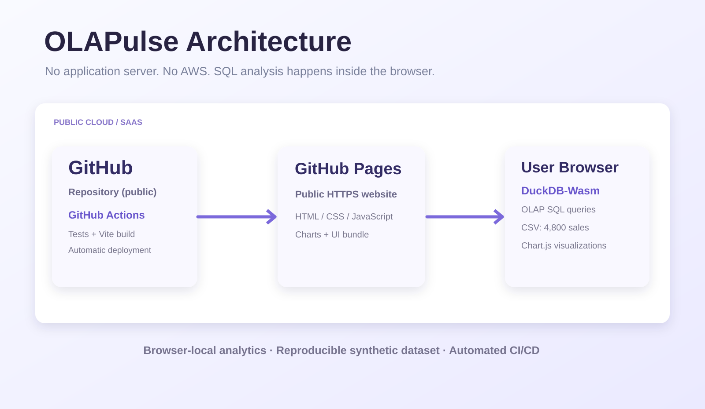

# OLAPulse — Interactive Sales Intelligence

> **Repository:** [Gino019/OLAPulse](https://github.com/Gino019/OLAPulse). GitHub Pages must be enabled and verified before treating the demo as live.

OLAPulse is a browser-powered OLAP (Online Analytical Processing) dashboard that transforms 4,800 **synthetic** retail transactions into interactive SQL-driven business insights. It runs **DuckDB-Wasm in the browser**, with **Chart.js** visualizations and automated deployment through **GitHub Actions → GitHub Pages**. It uses **no AWS** and no paid backend.


## Public links (complete after deployment)

- **Source code:** `https://github.com/Gino019/OLAPulse`
- **Live dashboard:** `https://Gino019.github.io/OLAPulse/`


## Features

- Live filtering by **year, region, product category, and sales channel**.
- KPI cards: **revenue, profit, order count, profit margin**.
- SQL-generated visualizations: **monthly trend, category share, regional breakdown, top five products**.
- **Five demonstrable OLAP operations:** Slice, Dice, Drill-down, Roll-up, Pivot.
- Readable **SQL query viewer** and interactive result tables.
- **Copy SQL**, **export query result CSV**, and **download source CSV**.
- Responsive design: desktop, tablet, and mobile.
- Automated **test, build, and deployment** on each push to `main`.

## Architecture



```text
public/data/sales.csv
        │
        ▼
DuckDB-Wasm (in the browser)
        │  SQL: GROUP BY / ROLLUP / conditional pivot
        ▼
JavaScript dashboard + Chart.js
        │
        ▼
GitHub Pages — public HTTPS

GitHub repository ──push──> GitHub Actions ──test/build/deploy──> GitHub Pages
```

**Privacy:** Only synthetic data is used; analytical queries execute inside the visitor's browser. A public CDN supplies the DuckDB-Wasm runtime binaries, so internet access is required on the first load.

## Run locally

Requirements: **Node.js 22** (or a supported Node.js version >=20.19), npm, and **Python 3** (to generate the reproducible synthetic CSV).

```bash
npm install
npm run dev
```

Open the local URL printed by Vite (normally `http://localhost:5173`).

Useful commands:

```bash
npm test       # unit tests for SQL query builders
npm run build  # production build -> dist/
npm run preview
python scripts/generate_data.py  # deterministic CSV regeneration
```

## What the SQL really does

**KPIs** are computed by DuckDB, not by JavaScript summation:

```sql
SELECT ROUND(SUM(revenue), 2) AS revenue,
       ROUND(SUM(profit), 2) AS profit,
       COUNT(*) AS orders
FROM sales
WHERE EXTRACT(YEAR FROM order_date) = 2025;
```

**Roll-up** uses actual OLAP aggregation:

```sql
SELECT region, category, SUM(revenue) AS revenue
FROM sales
GROUP BY ROLLUP (region, category);
```

**Pivot** uses portable conditional aggregation:

```sql
SELECT region,
  SUM(CASE WHEN channel = 'Online' THEN revenue ELSE 0 END) AS online,
  SUM(CASE WHEN channel = 'Retail' THEN revenue ELSE 0 END) AS retail,
  SUM(CASE WHEN channel = 'Partner' THEN revenue ELSE 0 END) AS partner
FROM sales GROUP BY region;
```

Use the **OLAP Explorer** in the app to inspect and run all five operations and see the results.

## Dataset

The generated file `public/data/sales.csv` (created on `npm run dev`, `npm test` and `npm run build`) contains **4,800 synthetic orders from 2023 to 2025**, including:

`order_id`, `order_date`, `region`, `category`, `product`, `channel`, `segment`, `quantity`, `unit_price`, `discount`, `revenue`, `profit`.

The CSV is generated locally and by CI rather than tracked in Git, to keep the repository lightweight. Recreate it with `python scripts/generate_data.py`. The generator uses a fixed random seed and does not access real user or customer information.

## Publishing with GitHub Actions (no AWS)

1. Create a **public** GitHub repository named **`OLAPulse`** (matching `vite.config.js`).
2. Push the source files to the **`main`** branch (see commands below).
3. Open **Settings → Pages → Build and deployment → Source: GitHub Actions**.
4. Open **Actions**, inspect the **CI and Deploy (GitHub Pages)** workflow, and confirm the run completed successfully.
5. Visit `https://Gino019.github.io/OLAPulse/`.
6. Repeat: change a source file, commit and push; GitHub Actions will automatically test, build and deploy.

**Note:** The Pages environment may need initial setup or organization/repository permission changes. GitHub Pages availability is subject to GitHub's current account policy.

If using a different repository name, update the `base` path in `vite.config.js`.

### Git commands (in the provided repository with local history)

```bash
# Create the empty public GitHub repository named OLAPulse first.
# From the root of this project:
git remote add origin https://github.com/Gino019/OLAPulse.git
git branch -M main
git push -u origin main
```

For Windows users with the official GitHub CLI (`gh`), you can also run `powershell -ExecutionPolicy Bypass -File scripts/publish_to_github.ps1` from the project root; the script authenticates through GitHub and creates/pushes the public repository. Verify all results in GitHub.

Use GitHub authentication when asked. Do not include passwords or access tokens in commits or screenshots.

## Academic evidence checklist

- [ ] Public GitHub URL, visible source code and commit history
- [ ] Green GitHub Actions CI/deployment run
- [ ] Public HTTPS GitHub Pages URL accessible in a private browser
- [ ] Medium publication in English with screenshots, architecture and source link
- [ ] Public video shorter than 5 minutes with app + pipeline proof
- [ ] Telegram group message with article and video links
- [ ] ZIP with real public links submitted to coursework platform

## Documentation

- [`docs/MEDIUM_ARTICLE.md`](docs/MEDIUM_ARTICLE.md): complete English article (upload supplied PNGs to Medium)
- [`docs/VIDEO_SCRIPT_ES.md`](docs/VIDEO_SCRIPT_ES.md): 4-minute Spanish voiceover script
- [`docs/VIDEO_SCRIPT_EN.md`](docs/VIDEO_SCRIPT_EN.md): short English video voiceover
- [`docs/PUBLISHING_GUIDE_ES.md`](docs/PUBLISHING_GUIDE_ES.md): detailed Spanish deployment and submission walkthrough
- [`submission/links_template.txt`](submission/links_template.txt): replace placeholders with public links and ZIP it for submission

## References

- [DuckDB-Wasm documentation](https://duckdb.org/docs/current/clients/wasm/overview)
- [DuckDB-Wasm instantiation](https://duckdb.org/docs/current/clients/wasm/instantiation)
- [Vite static deployment](https://vite.dev/guide/static-deploy)
- [GitHub Pages with custom workflows](https://docs.github.com/en/pages/getting-started-with-github-pages/using-custom-workflows-with-github-pages)
- [Chart.js](https://www.chartjs.org/docs/latest/)

## License

MIT. See [`LICENSE`](LICENSE).
