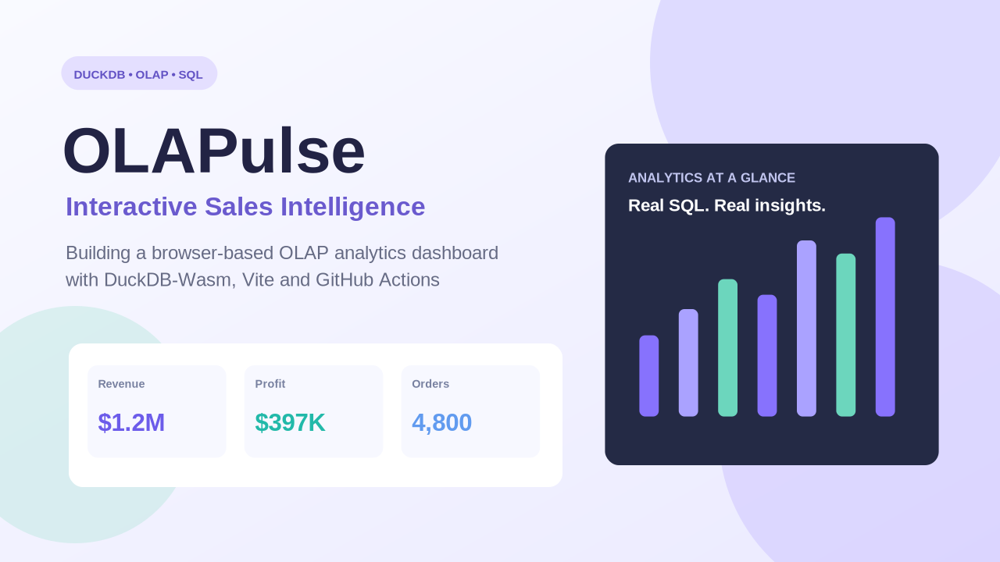
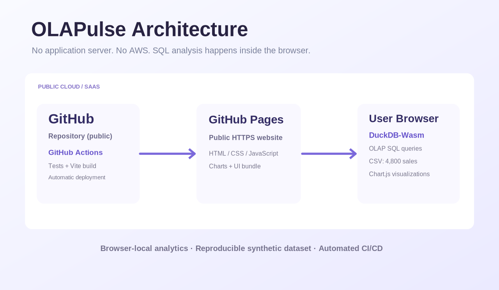
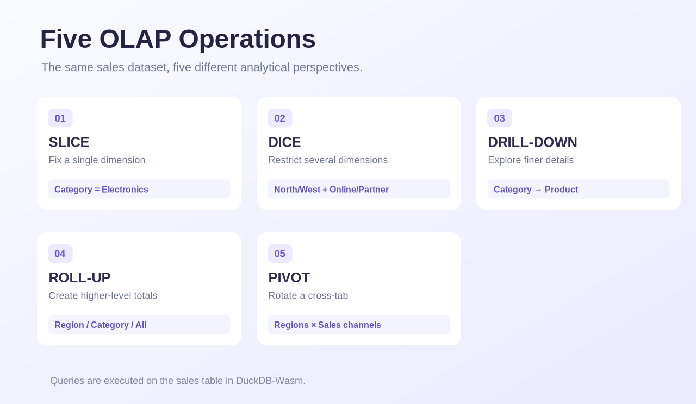

# Building OLAPulse: An Interactive OLAP Analytics Dashboard with DuckDB-Wasm, SQL, and GitHub Actions

**Subtitle:** A practical, serverless approach to business intelligence: build a sales analytics dashboard, demonstrate five OLAP operations, and deploy it automatically without AWS.

**Author:** [YOUR FULL NAME]

**Tags for Medium:** `OLAP` · `DuckDB` · `Business Intelligence` · `SQL` · `GitHub Actions`

**Project repository:** [OLAPulse on GitHub](https://github.com/YOUR_USERNAME/OLAPulse) — **replace `YOUR_USERNAME` with your account before publishing**.

**Live demo:** `https://YOUR_USERNAME.github.io/OLAPulse/` — **replace after a successful deployment**.



*Figure 1. OLAPulse, an interactive browser-based sales intelligence project. Original cover illustration.*

## 1. Introduction

Businesses collect transactions every day, but a spreadsheet of individual purchases does not automatically answer management questions. Which regions generate the most revenue? How is the product mix changing? Which sales channels are most profitable? Answering these questions requires aggregating data from different perspectives.

This is where **Online Analytical Processing (OLAP)** becomes useful. OLAP provides a way to explore data across dimensions, examine summaries, and move between broad overviews and detailed records.

To put the concept into practice, I built **OLAPulse**, a lightweight web application that uses **DuckDB-Wasm** as its analytical SQL engine and **Chart.js** to display interactive visualizations. Instead of provisioning a traditional database server, OLAPulse runs its queries directly inside the user's browser.

The source code is public, and a **GitHub Actions** workflow handles automated testing, building, and deployment to **GitHub Pages**. The project does **not use Amazon Web Services (AWS)**.

## 2. Project Objective

The main objective of OLAPulse is to **design, implement, and publish an interactive OLAP solution that helps users analyze retail sales through multidimensional SQL queries**.

More specifically, the application aims to:

- Turn raw transaction records into actionable business indicators.
- Allow users to filter sales data by year, region, product category, and channel.
- Demonstrate **slice, dice, drill-down, roll-up, and pivot** using real SQL queries.
- Display analytical results in charts and tables that are easy to interpret.
- Make the entire solution reproducible through public source code and automated deployment.

## 3. The Technology Stack

I selected tools that are accessible to students and can be hosted on a public platform without a paid cloud database.

| Layer | Technology | Responsibility |
|---|---|---|
| OLAP database | DuckDB-Wasm | Executes analytical SQL inside the browser |
| Interface | HTML, CSS, JavaScript | Filters, data tables, and dashboard interactions |
| Data visualization | Chart.js | Trend, regional, and category charts |
| Build system | Vite | Development server and optimized production bundle |
| Version control | Git and GitHub | Public repository and commit history |
| CI/CD | GitHub Actions | Tests, builds, and publishes after a push |
| Cloud hosting | GitHub Pages | Makes the website available through a public HTTPS URL |

DuckDB-Wasm is especially attractive for a teaching project because its SQL execution can be demonstrated without maintaining a remote database service. The browser still needs to download the WebAssembly runtime on the first visit, and available memory depends on the device.

## 4. Solution Architecture



*Figure 2. GitHub Actions builds the site, GitHub Pages hosts its files, and DuckDB-Wasm executes SQL in the visitor's browser.*

The architecture follows a straightforward sequence:

1. GitHub stores the dashboard source code and a synthetic CSV dataset.
2. A commit on `main` triggers the GitHub Actions workflow.
3. The workflow runs automated tests, builds the frontend with Vite, and deploys the `dist` directory to GitHub Pages.
4. Visitors open the published web page and load the CSV dataset.
5. DuckDB-Wasm processes SQL queries locally, returning grouped analytical results.
6. JavaScript renders the results using KPI cards, charts, and tables.

This design minimizes infrastructure requirements. There is no application server to administer and no separate database credential to configure. It is appropriate for a public demonstration with synthetic data, although it is not intended to replace a governed enterprise analytics platform.

## 5. Understanding the Dataset

The project includes **4,800 synthetic retail transactions from 2023 through 2025**. Every record has fields such as:

- `order_date`: transaction date.
- `region`: North, South, East, or West.
- `category` and `product`: product hierarchy.
- `channel`: Online, Retail, or Partner.
- `quantity`, `revenue`, and `profit`: numerical measures to aggregate.

The dataset is intentionally fictional, so the application can be shared publicly without exposing actual customer information. It can be recreated from a deterministic Python generator included in the repository.

In OLAP terminology, `revenue` and `profit` are **measures**, while `region`, `category`, `channel`, and year are **dimensions**. The product hierarchy enables a transition from category summaries to individual product performance.

## 6. Initializing DuckDB-Wasm

The application chooses a compatible DuckDB-Wasm bundle, starts a worker, downloads the sample CSV file, and registers it with the database engine.

```javascript
import * as duckdb from '@duckdb/duckdb-wasm';

const bundle = await duckdb.selectBundle(duckdb.getJsDelivrBundles());
const workerURL = URL.createObjectURL(new Blob([
  `importScripts(${JSON.stringify(bundle.mainWorker)});`
], { type: 'text/javascript' }));

const worker = new Worker(workerURL);
const db = new duckdb.AsyncDuckDB(new duckdb.ConsoleLogger(), worker);
await db.instantiate(bundle.mainModule, bundle.pthreadWorker);
const conn = await db.connect();
```

Once the CSV file has been registered in the virtual file system, the application creates a table for further analysis:

```sql
CREATE TABLE sales AS
SELECT *
FROM read_csv_auto('olapulse_sales.csv', HEADER = TRUE, SAMPLE_SIZE = -1);
```

The complete working implementation is in [`src/database.js`](https://github.com/YOUR_USERNAME/OLAPulse/blob/main/src/database.js).

## 7. Building the Sales Dashboard

The dashboard contains four key performance indicators: **total revenue, total profit, number of orders, and profit margin**. These values are computed through SQL aggregations rather than JavaScript loops.

```sql
SELECT
  ROUND(SUM(revenue), 2) AS revenue,
  ROUND(SUM(profit), 2) AS profit,
  COUNT(*) AS orders,
  ROUND(100.0 * SUM(profit) / NULLIF(SUM(revenue), 0), 2)
    AS profit_margin
FROM sales
WHERE EXTRACT(YEAR FROM order_date) = 2025;
```

Additional queries power a monthly revenue line chart, a category revenue doughnut chart, a regional comparison chart, and a top-products table. When a filter changes, the underlying SQL condition also changes, and the dashboard refreshes.

**[INSERT REAL DASHBOARD SCREENSHOT HERE]**

*Figure 3. OLAPulse dashboard after loading the 2025 sales data. Capture the live site showing all four KPIs and at least two charts.*

## 8. Demonstrating the Five OLAP Operations



*Figure 4. Five ways to analyze the same multidimensional dataset.*

**Slice** holds one dimension constant, such as selecting Electronics, and compares sales across regions:

```sql
SELECT region, ROUND(SUM(revenue), 2) AS revenue
FROM sales
WHERE category = 'Electronics'
GROUP BY region
ORDER BY revenue DESC;
```

**Dice** restricts multiple dimensions to form a smaller analytical subcube:

```sql
SELECT category, region, channel, SUM(revenue) AS revenue
FROM sales
WHERE region IN ('North', 'West')
  AND channel IN ('Online', 'Partner')
GROUP BY category, region, channel;
```

**Drill-down** moves from a broad product category to the more detailed product level:

```sql
SELECT category, product, SUM(revenue) AS revenue
FROM sales
GROUP BY category, product
ORDER BY category, revenue DESC;
```

**Roll-up** produces hierarchical subtotals and a grand total:

```sql
SELECT region, category, SUM(revenue) AS revenue
FROM sales
GROUP BY ROLLUP (region, category);
```

Finally, **pivot** turns sales channels into columns, making cross-channel comparison easier:

```sql
SELECT region,
  SUM(CASE WHEN channel = 'Online' THEN revenue ELSE 0 END) AS online,
  SUM(CASE WHEN channel = 'Retail' THEN revenue ELSE 0 END) AS retail,
  SUM(CASE WHEN channel = 'Partner' THEN revenue ELSE 0 END) AS partner
FROM sales
GROUP BY region;
```

These operations are not merely described in the article. The **OLAP Explorer** runs each query inside DuckDB-Wasm and displays the SQL text and the resulting table. Users can also copy the SQL and export the resulting records as CSV.

**[INSERT REAL OLAP EXPLORER SCREENSHOT HERE]**

*Figure 5. Running the ROLLUP operation in OLAPulse, including SQL text and grouped results.*

## 9. Automated Deployment with GitHub Actions

A key requirement of the project is to publish the application through automation rather than manually uploading each release.

The repository includes a `.github/workflows/deploy.yml` file. On every push to the `main` branch, GitHub Actions installs dependencies, runs tests, builds the application, and deploys the output to GitHub Pages.

```yaml
- uses: actions/setup-node@v4
  with:
    node-version: 22
- run: npm install --no-audit --no-fund
- run: npm test
- run: npm run build
  env:
    GITHUB_PAGES: 'true'
- uses: actions/upload-pages-artifact@v4
  with:
    path: dist/
```

A separate job publishes the uploaded artifact with `actions/deploy-pages@v4`. The full workflow is available in the [public repository](https://github.com/YOUR_USERNAME/OLAPulse/blob/main/.github/workflows/deploy.yml).

The initial setup also requires selecting **GitHub Actions** as the publishing source under **Settings → Pages**.

**[INSERT REAL GITHUB ACTIONS SCREENSHOT HERE]**

*Figure 6. Successful CI/CD workflow run showing the build and deploy stages. Only include this image after the deployment has actually succeeded.*

## 10. Outcomes, Limitations, and Lessons Learned

OLAPulse illustrates that a useful analytical application does not always require an expensive infrastructure stack. For small public datasets, **DuckDB-Wasm offers a convenient way to explore SQL aggregation directly from a static website**.

The most important lessons from this project are:

- OLAP is about changing analytical perspective, not just building attractive charts.
- SQL grouping, hierarchical aggregation, and conditional pivoting are practical techniques for multidimensional analysis.
- WebAssembly makes it possible to run a real analytical engine inside a browser.
- A public GitHub repository and CI/CD workflow improve reproducibility and make the implementation easier to review.

There are also limitations. Browser memory and network download size constrain the practical dataset size. The data is synthetic rather than representative of a production business. The project does not implement user authentication, incremental ETL pipelines, or server-side access controls. These are reasonable directions for a future version.

## 11. Conclusion

By combining DuckDB-Wasm, Chart.js, Vite, and GitHub Actions, I created **OLAPulse**, a compact OLAP demonstration that unites an analytical data engine, a responsive visual interface, five SQL-based OLAP operations, and an automated public deployment workflow — all **without AWS**.

If you want to reproduce the project, review its SQL queries, or adapt it to another dataset, the full source and setup instructions are available below.

**Source code:** [OLAPulse GitHub Repository](https://github.com/YOUR_USERNAME/OLAPulse)

**Live demo:** `https://YOUR_USERNAME.github.io/OLAPulse/`

**Video walkthrough:** `[ADD YOUR PUBLIC VIDEO LINK AFTER UPLOADING]`

## References

1. DuckDB. [DuckDB-Wasm Overview](https://duckdb.org/docs/current/clients/wasm/overview).
2. DuckDB. [DuckDB-Wasm Instantiation](https://duckdb.org/docs/current/clients/wasm/instantiation).
3. DuckDB. [Data Ingestion](https://duckdb.org/docs/current/clients/wasm/data_ingestion).
4. Vite. [Deploying a Static Site](https://vite.dev/guide/static-deploy).
5. GitHub Docs. [Using Custom Workflows with GitHub Pages](https://docs.github.com/en/pages/getting-started-with-github-pages/using-custom-workflows-with-github-pages).
6. Chart.js. [Getting Started](https://www.chartjs.org/docs/latest/getting-started/).

---

### Medium publishing checklist (remove this section before publishing)

- Replace **all** `YOUR_USERNAME`, author, demo, video, and other placeholders with real links.
- Add `docs/assets/article-cover.png` as the Medium cover image.
- Upload the PNG images `architecture.png` and `olap-operations.png` where their Figure placeholders appear (Medium does not automatically import relative Markdown images from your computer).
- Capture and upload **real** screenshots of the running dashboard, OLAP Explorer, and green GitHub Actions deployment.
- Set the article title, subtitle and tags in Medium; make the post publicly accessible.
- Check every clickable link from a private/incognito browser session.
